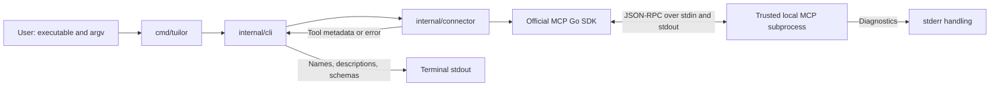

# Tuilor architecture

Status: evolving design, 2026-10-12. The local-first deployment direction is
recorded in [ADR 0001](adr/0001-initial-architecture.md). The Phase 1 package layout,
API boundary, CLI syntax, and timeout policy below are proposals awaiting review.
No Phase 1 production code exists yet.

## Product goals and non-goals

Build persistent, reusable terminal applications from natural-language requests
and connected MCP capabilities. Users customize declarative JSON without writing
Go. Generation and execution are separate: routine application interactions
should not require repeated LLM calls. Local operation, explicit permissions,
and portability between compatible MCP environments are priorities.

Initially, Tuilor is not a hosted platform, arbitrary-code generator, distributed
workflow engine, or general MCP debugger. Discovery is the first building block
of the application builder. Sharing and distribution wait until the local
product works reliably.

## Initial system context and requirements

Phase 1 has one user, one CLI invocation, and one explicitly trusted local MCP
server subprocess. It must connect over stdio, discover all available tools,
display each name, description, and input schema, handle connection failures,
honor cancellation/deadlines, and close sessions and processes cleanly.

The smallest proposed invocation is:

```sh
tuilor connect --timeout 10s -- /path/to/trusted-mcp-server server-arg
```

This is proposed syntax, not a working command. `--` separates Tuilor flags from
the server executable and its argv. The command performs discovery and exits;
it does not save a named connection. Named integrations such as `connect github`
require configuration design in a later milestone.

The 10-second default is a reviewable starting point for the complete discovery
operation, not a promise that every server can start within that time. Launch
one process per invocation; do not retry or reconnect automatically.

## Phase 1 proposed package structure

```text
cmd/
  tuilor/
    main.go
internal/
  cli/
    run.go
    format.go
    run_test.go
    format_test.go
  connector/
    discover.go
    discover_integration_test.go
    testdata/
      mcpserver/
        main.go
go.mod
go.sum
```

This tree is a proposal; none of these Go files or module files are created during
initialization. Preserve or move the existing empty root `main.go` only when the
entry-point decision is agreed. Choose the actual repository module path and
compatible Go/SDK versions at implementation time.

| Component | Responsibility | Must not own |
| --- | --- | --- |
| `cmd/tuilor` | Wire arguments and streams, create a signal-aware root context, call CLI, exit after cleanup | MCP protocol behavior or formatting |
| `internal/cli` | Parse and validate flags, apply operation timeout, invoke discovery, format metadata, map errors to exit status | Session or subprocess ownership |
| `internal/connector` | Construct command transport, connect, enumerate tools, wrap errors, close session and reap child | CLI parsing, terminal layout, future registry or AI |
| Test MCP server | Expose deterministic tools and controlled failure modes over stdio | Production service access or real credentials |

Use the standard-library `flag` package first; a command framework adds convenience
as commands grow but brings a dependency and conventions before they are needed.
`internal` limits imports from other modules. Package separation provides a code
boundary, not process isolation.

## Communication and interface boundaries



The CLI calls a discovery operation using a context and explicit executable/argv.
It receives metadata or an error after resource cleanup. It does not manipulate
SDK sessions. The SDK owns wire framing, protocol negotiation, and request
correlation; Tuilor owns application policy and resource-lifetime decisions.

Proposed documentation-only API sketch for option A:

```go
type Command struct {
    Executable string
    Args       []string
}

func Discover(ctx context.Context, command Command) ([]*mcp.Tool, error)
```

This operation connects, collects metadata, and closes the session. Returning SDK
tool values is a deliberate Phase 1 coupling; do not introduce the normalized
Phase 2 registry early. The caller owns its returned snapshot. Keep original JSON
schema structure, including nested fields, when formatting; do not flatten it
into a custom schema model. The human-facing renderer escapes terminal controls
in strings and serializes input schemas as readable JSON.

The official SDK exposes `CommandTransport`, `Client.Connect`, `ClientSession.Tools`
(an iterator that handles pagination), and `ClientSession.Close`. Prefer the
iterator over implementing cursor traversal ourselves. Verify APIs against the
chosen dependency version before coding. [Official SDK API documentation](https://pkg.go.dev/github.com/modelcontextprotocol/go-sdk/mcp).

### Decision to review: concrete SDK use or our own interface?

The system design concept is dependency inversion: callers can depend on the
operation they need rather than a vendor implementation. A separate package
already gives us a place to change integration policy; a Go interface adds a
substitution seam, and a custom data model adds a stronger compatibility boundary.
These are different choices.

| Approach | Advantages | Disadvantages | Effect on extension |
| --- | --- | --- | --- |
| A: Concrete discovery function using the SDK directly inside `connector` | Least code; real protocol integration tests; SDK semantics stay visible | SDK tool types cross into CLI; pure CLI orchestration tests may need a small function injection seam | Add an interface or normalized registry when actual consumers need it |
| B: A small consumer-owned `Discoverer` interface backed by an SDK adapter | Easy CLI fakes; callers depend on one operation; supports an alternate implementation | Extra wiring for a single implementation; retaining SDK types still couples the data contract | Useful when the TUI or another discovery backend becomes a real consumer |

**Recommendation: A for Phase 1.** Keep lifecycle policy in a concrete connector
function and unit-test formatting separately. Introduce function injection only
if orchestration tests need it. Choose B if practicing interface-based injection
is a specific learning priority now; keep it to one discovery method and continue
using SDK tool types for this milestone. Neither option requires a large SDK
facade, transport factory, normalized registry, or generic connection manager.

For B, the proposed consumer-owned contract is:

```go
type Discoverer interface {
    Discover(context.Context, connector.Command) ([]*mcp.Tool, error)
}
```

## Lifecycle, data flow, and error contract

1. Validate arguments and positive timeout before starting a process. Create a
   signal-aware root context and a child deadline for the entire discovery run.
2. Resolve the user-selected executable and construct separate argv without a
   shell. The connector owns the command; the SDK transport starts it.
3. Connect and let the SDK establish protocol readiness. A server without tool
   support produces a clear unsupported-capability failure rather than being
   confused with a valid empty list.
4. Enumerate all pages within the same deadline. Accumulate a single snapshot;
   an enumeration failure returns an error and no partial success output.
5. Close the session on every path after acquisition. Cover errors after process
   launch but before a usable session with integration tests of the pinned SDK.
6. Return metadata only after cleanup; format it to stdout. Send diagnostics to
   stderr and return a nonzero status for discovery, cleanup, or output failures.

Proposed policy: a supported server returning zero tools is a successful empty
result; missing descriptions are allowed; omitted/invalid required metadata or
unserializable schemas are errors. A valid schema is displayed, not evaluated
for tool execution. Full schema validation belongs to the registry milestone.

Use operation-specific error context such as `connect server` and `list tools`,
preserving wrapped causes for `errors.Is`/`errors.As`. Preserve the original error
if cleanup also fails, for example with `errors.Join`. Define cancellation and
deadline errors distinctly in diagnostics. Avoid dumping argv or environment
values that may contain credentials.

Cancellation is a request to stop work, not proof a subprocess has exited. The
discovery deadline and cleanup budget are distinct: cleanup may take additional
time after the operation deadline. Do not bind a long-lived process to a short
connection-only context. For this one-shot operation, the request context governs
discovery, and explicit session closure governs shutdown.

The current SDK command transport closes stdin, waits, then escalates termination
of its direct child. Its `TerminateDuration` applies to shutdown stages rather
than the discovery deadline. Use the SDK lifecycle before writing another process
manager; verify deadline and close behavior for the pinned version. Do not call
`Wait` a second time on the SDK-owned command. [SDK command transport source](https://github.com/modelcontextprotocol/go-sdk/blob/main/mcp/cmd.go).

Initial support should target directly launched foreground servers. Descendants,
launcher scripts, and OS-specific process-tree termination require explicit
support decisions; do not claim the SDK guarantees cleanup of an entire tree.
Test cleanup on the supported operating systems before promising portability.

## Trust boundaries

- **User to process launch:** only an explicitly trusted executable is started.
  It has the user's OS access, potentially including network access; discovery
  alone cannot prevent side effects performed by the server at startup.
- **Subprocess to connector:** descriptions and schemas are untrusted data.
  They cannot authorize commands, change policy, or act as AI instructions.
- **Metadata to terminal:** escape control sequences to prevent metadata from
  manipulating the terminal. Do not fetch external schema references or icons.
- **Protocol versus diagnostics:** server stdout carries MCP messages; stderr is
  diagnostic data. Stderr text alone does not establish failure. For Phase 1,
  propose draining and discarding server stderr by default; adding bounded,
  escaped diagnostics is a separate reviewed option. Never merge it into the
  protocol stream. [MCP stdio specification](https://modelcontextprotocol.io/specification/2025-11-25/basic/transports).
- **Future generation to runtime:** definitions must pass structural and capability
  validation. Explicit permissions gate tool effects; model output and server
  annotations are not permission grants. Credential storage is a later decision.

## Failure cases and testing strategy

| Scenario | Proposed behavior | Verification |
| --- | --- | --- |
| Missing executable, invalid timeout, malformed CLI arguments | Reject before launch | Table-driven CLI tests; nonexistent executable integration case |
| Process cannot start or exits during connection | Return actionable startup/connection error | Missing binary and early-exit fixtures |
| Server stalls during connection or listing | Deadline error followed by cleanup | Controlled blocked-server modes and bounded completion checks |
| User interrupts or caller cancels | Cancel discovery and close resources | Context cancellation integration test; CLI subprocess signal test |
| No tool capability | Clear capability failure | Fixture without tools capability |
| Valid empty tool list or omitted description | Successful display | Empty-capable server and metadata formatting tests |
| Multiple pages | Collect every tool | Fixture serving controlled cursors and later-page errors |
| JSON/schema corruption or garbage on protocol stdout | Protocol/data error; no partial success | Fault fixture or low-level scripted peer |
| Metadata contains terminal escapes | Display escaped data | Renderer tests with escape/control characters and nested schemas |
| Server emits lots of stderr | Keep protocol functional and avoid blocked pipes | Noisy-server integration fixture |
| Server refuses shutdown | Escalate within documented cleanup budget | Stubborn direct-child fixture; verify PID exit and process reaping |
| Discovery and cleanup both fail | Preserve both causes | Targeted error-composition test |
| Output writer fails | Report output failure after connector cleanup | Failing writer test |

Build a minimal official-SDK MCP server under testdata with deterministic tool
names, descriptions, and schemas. Build it once per integration suite into a
temporary directory and run it through the real command transport. Advertise tool
support explicitly for the empty-list case. Use readiness markers/control pipes
instead of sleeps for cancellation tests. Keep cleanup hooks in the tests so a
failed assertion cannot leave fixtures running.

Use the official SDK for healthy protocol fixtures. For intentionally malformed
messages or unusual pagination behavior, use a narrow scripted peer where the
high-level SDK would enforce correctness. Test the actual subprocess boundary;
in-memory transports alone cannot verify startup, stdio, signals, or reaping.
No integration test should depend on GitHub, Linear, credentials, or network access.

After implementation, run relevant unit/integration tests, `go test ./...`,
`go test -race ./...`, and `go vet ./...`. Establish practical time bounds with
scheduler tolerance rather than exact timing assertions. SDK background goroutines
do not justify adding our own worker pool: one request and one session suffice.

Acceptance: the happy path displays all requested metadata; failures are clear;
pagination is complete; cancellation/deadlines terminate work; direct child
cleanup is verified on supported platforms; no MCP tool is called.

## Planned logical components beyond Phase 1

These are conceptual responsibilities, not packages to create now.

| Phase | Component | Responsibility |
| --- | --- | --- |
| 2 | Tool registry | Normalize capabilities and define schema/freshness rules |
| 3 | Application generator and validator | Convert requests plus capabilities into validated JSON definitions through a provider-agnostic LLM boundary |
| 4 | TUI runtime | Render definitions with Bubble Tea, Bubbles, and Lip Gloss; load data asynchronously |
| 5 | Application store/editor | Persist, customize, version, and migrate local definitions |
| 6 | Workflow executor and permission policy | Bind tools across servers and control authorized effects, retries, and concurrency |
| 7 | Sharing/distribution | Export and install portable definitions with compatibility checks |

Planned generation flow: request + tool registry -> LLM -> candidate definition
-> validation -> user review -> local application store.

Planned execution flow: saved definition -> validation and capability binding
-> TUI event -> permission check -> MCP operation -> state update -> rendering.
Routine interactions follow the execution flow without requiring another LLM call.

## Assumptions and open questions

- One foreground server per discovery invocation is sufficient initially.
- Local-first refers to Tuilor control and storage, not guaranteed offline access
  to services behind MCP servers. Credentials are already configured outside
  Tuilor for Phase 1; do not add a credential manager now.
- The tool list is a discovery snapshot. Phase 2 must define invalidation and
  changing-capability handling; Phase 1 has no persistent cache.
- **Review now:** concrete SDK use (A) or narrow interface (B); proposed package
  layout; one-shot CLI syntax; operation/cleanup budgets; server stderr policy;
  supported OS and direct-child process assumptions.
- **Before implementation:** repository module path, compatible Go/SDK versions,
  exit-status mapping, fixture shutdown limits, and environment inheritance policy.
- **Later milestones:** stable tool identities, JSON application schema and
  versioning, capability rebinding, LLM provider contract, permission granularity,
  secret handling, migrations, workflow recovery, and portable export rules.

Learning focus for Phase 1: package cohesion versus interface abstraction,
client/session lifetime ownership, Go contexts and cancellation, protocol versus
application policy, error identity, and integration tests across a process boundary.
Be able to explain why each boundary exists and what evidence would change it.
